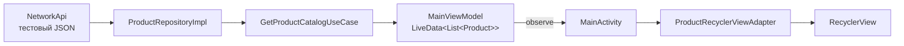

# Практическая работа № 4
### Списки в Android: ScrollView, ListView, RecyclerView

**Дисциплина:** Разработка мобильных приложений  
**Язык реализации:** Java  
**Проекты:** `MovieProject` и `FoodScan`  
**Студент:** Хречко Роман    
**Группа:** БСБО-09-23


## Содержание

- [Что требовалось](#что-требовалось)
- [1. ScrollViewApp](#1-scrollviewapp)
- [2. ListViewApp](#2-listviewapp)
- [3. RecyclerViewApp](#3-recyclerviewapp)
- [4. FoodScan: каталог в RecyclerView](#4-foodscan-каталог-в-recyclerview)
- [Проверка выполнения](#проверка-выполнения)

---

## Что требовалось

| Часть | Требование | Реализация |
|---|---|---|
| 1.1 | Отобразить 100 членов геометрической прогрессии со знаменателем 2 внутри `ScrollView` | `MovieProject/scrollviewapp` |
| 1.2 | Создать список авторов и книг, который содержит более 30 записей | `MovieProject/listviewapp` |
| 1.3 | Создать список исторических событий с коротким описанием и изображением | `MovieProject/recyclerviewapp` |
| Контрольное задание | Получить тестовые данные через репозиторий, передать в слой представления с помощью `LiveData` и отобразить в `RecyclerView` | `FoodScan/app` |

В `MovieProject/settings.gradle.kts` зарегистрированы три самостоятельных Android application-модуля: `scrollviewapp`, `listviewapp` и `recyclerviewapp`. Основные модули `app`, `data` и `domain` не удалялись и не перестраивались.

---

## 1. ScrollViewApp

Пакет: `ru.mirea.khrechko.scrollviewapp`.

На экране размещён заголовок и вертикально прокручиваемый список из 100 членов геометрической прогрессии с первым членом `b₁ = 1` и знаменателем `q = 2`. Каждый элемент списка создаётся из `item.xml` с использованием `LayoutInflater` и добавляется в контейнер `LinearLayout`, расположенный внутри `ScrollView`.

Для хранения чисел используется `BigInteger`, потому что 100-й член равен `2^99` и не помещается в `long`.

Ключевой фрагмент `MainActivity.java`:

```java
LinearLayout wrapper = findViewById(R.id.wrapper);
BigInteger value = BigInteger.ONE;
for (int i = 0; i < 100; i++) {
    View item = getLayoutInflater().inflate(R.layout.item, wrapper, false);
    TextView index = item.findViewById(R.id.textViewIndex);
    TextView number = item.findViewById(R.id.textViewValue);
    index.setText(String.format(
            Locale.getDefault(), "Элемент %d · b%d = 2^%d",
            i + 1, i + 1, i));
    number.setText(value.toString());
    wrapper.addView(item);
    value = value.multiply(BigInteger.valueOf(2));
}
```

Проверка: в начале списка должны находиться числа `1`, `2`, `4`, `8`, `16`; при прокрутке можно добраться до элемента 100.


**Рисунок 1 — ScrollViewApp: первые элементы геометрической прогрессии.**

---

## 2. ListViewApp

Пакет: `ru.mirea.khrechko.listviewapp`.

В модуле реализован список из **35 книг**. Модель `Book` хранит название произведения и имя автора. Для отображения используется `ListView` и `ArrayAdapter` со стандартной двухстрочной разметкой `android.R.layout.simple_list_item_2`: в первой строке отображается номер и название книги, во второй — автор.

Переопределённый `getView()` заполняет обе строки. При нажатии на запись приложение показывает `Toast` с названием выбранной книги и её автором.

```java
ArrayAdapter<Book> adapter = new ArrayAdapter<Book>(this,
        android.R.layout.simple_list_item_2, android.R.id.text1, books) {
    @Override
    public View getView(int position, View convertView, ViewGroup parent) {
        View row = super.getView(position, convertView, parent);
        TextView title = row.findViewById(android.R.id.text1);
        TextView author = row.findViewById(android.R.id.text2);
        Book book = getItem(position);
        if (book != null) {
            title.setText((position + 1) + ". " + book.getTitle());
            author.setText(book.getAuthor());
        }
        return row;
    }
};
booksList.setAdapter(adapter);
```

Проверка: на экране присутствует более 30 записей, список прокручивается, нажатие на книгу выводит сообщение с её названием и автором.


**Рисунок 2 — ListViewApp: список книг и авторов.**

---

## 3. RecyclerViewApp

Пакет: `ru.mirea.khrechko.recyclerviewapp`.

Создан прокручиваемый список из десяти исторических событий. Для каждой записи используются год, название, короткое описание и имя локального векторного изображения. В качестве примеров включены первое письменное упоминание Москвы, Куликовская битва, основание Санкт-Петербурга, отмена крепостного права, первый полёт человека в космос и другие события.

Структура элемента находится в `event_item_view.xml`. Карточка включает `ImageView` и три текстовых поля. Модель `HistoricalEvent` хранит данные события. `EventViewHolder` удерживает ссылки на компоненты строки, а `EventRecyclerViewAdapter` создаёт элементы и связывает их с данными в методе `onBindViewHolder()`.

```java
@Override
public void onBindViewHolder(@NonNull EventViewHolder holder, int position) {
    HistoricalEvent event = events.get(position);
    holder.year.setText(String.valueOf(event.getYear()));
    holder.title.setText(event.getTitle());
    holder.description.setText(event.getDescription());
    int imageId = context.getResources().getIdentifier(
            event.getImageName(), "drawable", context.getPackageName());
    holder.image.setImageResource(
            imageId == 0 ? android.R.drawable.ic_menu_report_image : imageId);
}

@Override
public int getItemCount() {
    return events.size();
}
```

В `MainActivity` настраиваются `LinearLayoutManager` и адаптер `EventRecyclerViewAdapter`. Иллюстрации находятся в `recyclerviewapp/src/main/res/drawable/`; для работы экрана сетевое подключение не требуется.

Проверка: на экране отображаются карточки событий с годом, названием, описанием и иллюстрацией; список прокручивается, нажатие на карточку отображает краткое уведомление.


**Рисунок 3 — RecyclerViewApp: карточки исторических событий.**

---

## 4. FoodScan: каталог в RecyclerView

Контрольное задание выполнено в приложении `FoodScan`. Использован существующий тестовый источник каталога продуктов `NetworkApi`, содержащий JSON-массив продуктов. `ProductRepositoryImpl` получает DTO из сетевой заглушки и преобразует их в доменную модель `Product`. `GetProductCatalogUseCase` предоставляет каталог модели представления.

Поток данных:



В `MainViewModel` каталог загружается через use case в фоновом исполнителе и публикуется через `catalogFromNetwork`. Публичный метод `getCatalog()` возвращает `LiveData<List<Product>>`. `MainActivity` наблюдает изменения этого объекта и передаёт список адаптеру:

```java
viewModel.getCatalog().observe(this, adapter::setItems);
```

Вместо ранее использовавшегося `ListView` в `activity_main.xml` размещён `RecyclerView`. Новый адаптер `ProductRecyclerViewAdapter` реализует методы `onCreateViewHolder()`, `onBindViewHolder()` и `getItemCount()`. Для отображения фотографии используется Glide, уже подключённый в проекте. Нажатие на продукт по-прежнему открывает `ProductDetailActivity`.

Таким образом, требование контрольного задания выполнено: тестовые JSON-данные проходят через репозиторий и use case, передаются в интерфейс с помощью `LiveData` и отображаются в `RecyclerView`.


**Рисунок 4 — FoodScan: каталог продуктов в RecyclerView.**

---

## Проверка выполнения

| Проверка | Ожидаемый результат |
|---|---|
| Запуск `ScrollViewApp` | 100 членов прогрессии; начало списка `1, 2, 4, 8, 16` |
| Прокрутка `ScrollViewApp` | Доступен 100-й член; большое значение отображается полностью |
| Запуск `ListViewApp` | Не менее 31 записи; в записи указаны книга и автор |
| Нажатие на книгу | Отображается `Toast` с названием и автором |
| Запуск `RecyclerViewApp` | Карточки исторических событий содержат год, название, описание и векторную иллюстрацию |
| Запуск FoodScan | Каталог, полученный из мок-репозитория, отображается в `RecyclerView` |
| Получение каталога | После обновления `LiveData` адаптер получает список продуктов |
| Нажатие на продукт FoodScan | Открывается страница выбранного продукта |

### Соответствие методичке

| Требование | Где реализовано |
|---|---|
| `ScrollView`, `LayoutInflater`, 100 членов прогрессии | `MovieProject/scrollviewapp` |
| `ListView` и список из более чем 30 книг | `MovieProject/listviewapp` |
| `RecyclerView`, адаптер, `ViewHolder`, изображения исторических событий | `MovieProject/recyclerviewapp` |
| Мок-данные в репозитории | `FoodScan/.../data/network/NetworkApi.java`, `ProductRepositoryImpl.java` |
| Передача списка через `LiveData` | `FoodScan/.../MainViewModel.java` |
| Отображение мок-данных в `RecyclerView` | `FoodScan/.../MainActivity.java`, `ProductRecyclerViewAdapter.java` |


## Заключение

В `MovieProject` добавлены три учебных модуля для демонстрации `ScrollView`, `ListView` и `RecyclerView`. В контрольной части `FoodScan` тестовый каталог проходит через слой данных и ViewModel, передаётся в Activity посредством `LiveData` и отображается в `RecyclerView`. Существующая бизнес-логика FoodScan, обработка избранного, поиск по штрихкоду и открытие карточки продукта сохранены.
