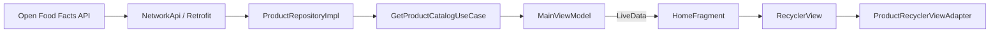

# Практическая работа № 6
## Fragment, FragmentManager и передача данных между фрагментами

**Дисциплина:** Разработка мобильных приложений  
**Язык реализации:** Java  
**Проекты:** `MovieProject` и `FoodScan`  
**Студент:** Хречко Роман  
**Группа:** БСБО-09-23  

---

## Содержание

1. [Цель работы](#1-цель-работы)
2. [Задачи работы](#2-задачи-работы)
3. [Теоретические сведения](#3-теоретические-сведения)
4. [Базовая часть: MovieProject](#4-базовая-часть-movieproject)
   - [4.1. Создание учебных модулей](#41-создание-учебных-модулей)
   - [4.2. FragmentApp: создание и использование Fragment](#42-fragmentapp-создание-и-использование-fragment)
   - [4.3. FragmentManagerApp: транзакции и back stack](#43-fragmentmanagerapp-транзакции-и-back-stack)
   - [4.4. Передача данных через общую ViewModel](#44-передача-данных-через-общую-viewmodel)
   - [4.5. ResultApiFragmentApp: Fragment Result API](#45-resultapifragmentapp-fragment-result-api)
5. [Контрольное задание: FoodScan](#5-контрольное-задание-foodscan)
   - [5.1. Новая структура экранов](#51-новая-структура-экранов)
   - [5.2. Навигация через FragmentManager](#52-навигация-через-fragmentmanager)
   - [5.3. ViewModel и отображение каталога](#53-viewmodel-и-отображение-каталога)
   - [5.4. Карточка продукта и избранное](#54-карточка-продукта-и-избранное)
   - [5.5. Фрагмент профиля и авторизация](#55-фрагмент-профиля-и-авторизация)
   - [5.6. Обновление дизайна FoodScan](#56-обновление-дизайна-foodscan)
6. [Заключение](#6-заключение)

---

## 1. Цель работы

Изучить принципы создания и использования фрагментов в Android-приложениях, освоить управление ими с помощью `FragmentManager`, научиться выполнять транзакции и сохранять переходы в back stack. Дополнительно требуется изучить способы обмена данными между Activity и Fragment, а также между несколькими фрагментами с помощью `Bundle`, общей `ViewModel` и `Fragment Result API`.

В базовой части задания новые учебные модули создаются в проекте `MovieProject`. Контрольное задание выполняется в проекте `FoodScan`: список продуктов должен отображаться с использованием `ViewModel` и нескольких фрагментов, а также необходимо добавить фрагмент профиля, основанный на данных авторизации. Для экранов и переходов используется `FragmentManager` с поддержкой возврата к предыдущему экрану.

Дополнительно внешний вид приложения `FoodScan` переработан по предоставленному прототипу `FoodScan_prototype.html`.

## 2. Задачи работы

1. Создать модуль `FragmentApp` и реализовать экран со списком задач и статусом выполнения.
2. Передать во фрагмент номер по списку с помощью `Bundle`.
3. Создать модуль `FragmentManagerApp`, содержащий фрагмент списка и фрагмент подробной информации о выбранном элементе.
4. Реализовать переключение фрагментов с помощью транзакций `FragmentManager` и возврат с помощью back stack.
5. Организовать обмен данными между фрагментами через общую `ViewModel` и `LiveData`.
6. Создать модуль `ResultApiFragmentApp` и передать текст между фрагментами с помощью `Fragment Result API`.
7. Использовать `BottomSheetDialogFragment` для отображения полученного результата.
8. В контрольном задании `FoodScan` реализовать навигацию между экранами на основе фрагментов.
9. Использовать общую `ViewModel` для состояния главного экрана и данных каталога.
10. Добавить экран профиля, который различает гостевой и авторизованный режимы.
11. Переделать визуальное оформление `FoodScan` в соответствии с HTML-прототипом.

## 3. Теоретические сведения

**Fragment** — компонент Android, который представляет отдельную часть пользовательского интерфейса и имеет собственный жизненный цикл. Фрагмент обычно размещается внутри Activity. В отличие от отдельной Activity, несколько фрагментов могут управляться одной host-активностью, что упрощает повторное использование экранов и построение адаптивной навигации.

Для размещения фрагмента в разметке Activity используется контейнер `FragmentContainerView`. Сам фрагмент наследуется от `androidx.fragment.app.Fragment`, создаёт свой интерфейс в `onCreateView()` и настраивает элементы в `onViewCreated()`.

**FragmentManager** управляет добавлением, удалением и заменой фрагментов. Набор операций выполняется в транзакции `FragmentTransaction`. Наиболее часто используемые методы:

- `add()` — добавить фрагмент в контейнер;
- `replace()` — заменить текущий фрагмент другим;
- `remove()` — удалить фрагмент;
- `addToBackStack()` — сохранить транзакцию в стеке навигации;
- `popBackStack()` — вернуться к предыдущему состоянию.

**ViewModel** используется для хранения состояния интерфейса, которое должно быть доступно нескольким UI-компонентам. Если два фрагмента получают ViewModel с областью действия Activity через `ViewModelProvider(requireActivity())`, они используют один экземпляр. Для наблюдения за данными применяется `LiveData`.

**Fragment Result API** предназначен для передачи результата между компонентами, которым не требуется постоянно совместно хранить состояние. Отправитель помещает данные в `Bundle` и вызывает `setFragmentResult()` с определённым ключом. Получатель заранее устанавливает `setFragmentResultListener()` с тем же ключом. Компоненты не должны хранить прямые ссылки друг на друга.

`BottomSheetDialogFragment` — разновидность диалогового фрагмента, который отображается в виде панели, выдвигающейся снизу экрана. В работе он используется для показа результата передачи данных.

## 4. Базовая часть: MovieProject

Все задания до контрольного выполнены в проекте `MovieProject`. Для них добавлены три отдельных Android application-модуля: `FragmentApp`, `FragmentManagerApp` и `ResultApiFragmentApp`. Существующие модули проекта не удалялись.

В `MovieProject/settings.gradle.kts` зарегистрированы новые модули:

```kotlin
include(":FragmentApp")
include(":FragmentManagerApp")
include(":ResultApiFragmentApp")
```

В version catalog добавлены зависимости AndroidX Fragment `1.8.5`, RecyclerView `1.4.0`, Lifecycle ViewModel и LiveData. В учебных модулях используются компоненты AndroidX и Material Components для элементов интерфейса. В `FoodScan` дополнительно применяется `BottomNavigationView` для основной навигации.

### 4.1. Создание учебных модулей

Каждый учебный модуль имеет собственную `MainActivity`, разметки и `AndroidManifest.xml`. Это позволяет запускать и проверять задания независимо друг от друга, не смешивая их интерфейсы с основным экраном `MovieProject`.

Структура добавленных модулей:

```text
MovieProject/
├── FragmentApp/
│   └── src/main/
│       ├── java/ru/mirea/khrechko/fragmentapp/
│       │   ├── MainActivity.java
│       │   └── TasksFragment.java
│       └── res/layout/
│           ├── activity_main.xml
│           ├── fragment_tasks.xml
│           └── item_task.xml
│
├── FragmentManagerApp/
│   └── src/main/
│       ├── java/ru/mirea/khrechko/fragmentmanagerapp/
│       │   ├── MainActivity.java
│       │   ├── CountryListFragment.java
│       │   ├── CountryDetailsFragment.java
│       │   └── CountrySelectionViewModel.java
│       └── res/layout/
│
└── ResultApiFragmentApp/
    └── src/main/
        ├── java/ru/mirea/khrechko/resultapifragmentapp/
        │   ├── MainActivity.java
        │   ├── DataFragment.java
        │   └── BottomSheetFragment.java
        └── res/layout/
```

### 4.2. FragmentApp: создание и использование Fragment

В модуле `FragmentApp` реализовано приложение для просмотра списка задач и состояния их выполнения. `MainActivity` выступает host-активностью и содержит `FragmentContainerView`, в который при первом создании добавляется `TasksFragment`.

Добавление фрагмента выполняется только при `savedInstanceState == null`. Это необходимо, чтобы после пересоздания Activity, например при изменении конфигурации устройства, не создавать второй экземпляр фрагмента поверх уже восстановленного системой.

```java
if (savedInstanceState == null) {
    Bundle args = new Bundle();
    args.putInt(ARG_STUDENT_NUMBER, STUDENT_LIST_NUMBER);

    TasksFragment fragment = new TasksFragment();
    fragment.setArguments(args);

    getSupportFragmentManager().beginTransaction()
            .setReorderingAllowed(true)
            .add(R.id.fragment_container, fragment, "tasks")
            .commit();
}
```

Для передачи номера по списку используется объект `Bundle`. В `MainActivity` он создаётся с ключом `my_number_student`, после чего передаётся фрагменту методом `setArguments()`. В `TasksFragment` значение извлекается через `requireArguments().getInt()` и отображается на экране.

На экране выводятся четыре задачи. У каждой задачи есть `CheckBox` и текстовый статус. При переключении флажка статус конкретного пункта меняется, а счётчик выполнения пересчитывается. Для отображения списка используется `RecyclerView` с собственным адаптером и `ViewHolder`.


**Рисунок 1 — Экран FragmentApp со списком задач, номером по списку и статусами выполнения.**

### 4.3. FragmentManagerApp: транзакции и back stack

В модуле `FragmentManagerApp` реализован список стран и отдельный экран с подробной информацией о выбранной стране.

Начальный экран создаёт `CountryListFragment`. В нём находится `RecyclerView` с пятью элементами: Россия, Япония, Франция, Бразилия и Канада. Для каждого элемента отображаются название, флаг-эмодзи и столица.

При нажатии на страну выполняются два действия:

1. Выбранный объект передаётся в общую `CountrySelectionViewModel`.
2. `CountryListFragment` заменяется на `CountryDetailsFragment`, а транзакция добавляется в back stack.

```java
selection.select(country);

getParentFragmentManager().beginTransaction()
        .setReorderingAllowed(true)
        .replace(R.id.fragment_container,
                new CountryDetailsFragment(), "country_details")
        .addToBackStack("country_details")
        .commit();
```

`CountryDetailsFragment` отображает флаг, название страны, столицу, примерную численность населения и краткое описание. Кнопка возврата вызывает `popBackStack()`, благодаря чему пользователь возвращается к прежнему списку стран.


**Рисунок 2 — Список стран в модуле FragmentManagerApp.**


**Рисунок 3 — Экран подробной информации о выбранной стране.**

### 4.4. Передача данных через общую ViewModel

Для обмена данными между `CountryListFragment` и `CountryDetailsFragment` создан класс `CountrySelectionViewModel`, наследующий `ViewModel`. Выбранная страна хранится в `MutableLiveData<CountryInfo>`.

```java
public class CountrySelectionViewModel extends ViewModel {
    private final MutableLiveData<CountryInfo> selectedCountry =
            new MutableLiveData<>();

    public LiveData<CountryInfo> getSelectedCountry() {
        return selectedCountry;
    }

    public void select(CountryInfo country) {
        selectedCountry.setValue(country);
    }
}
```

Оба фрагмента получают один экземпляр ViewModel с областью действия Activity:

```java
CountrySelectionViewModel selection =
        new ViewModelProvider(requireActivity())
                .get(CountrySelectionViewModel.class);
```

Экран деталей подписывается на `LiveData` с помощью `getViewLifecycleOwner()`. После выбора новой страны `LiveData` получает новое значение, и наблюдатель обновляет все соответствующие поля интерфейса. Таким образом, фрагменты обмениваются данными через общий объект состояния и не обращаются друг к другу напрямую.

### 4.5. ResultApiFragmentApp: Fragment Result API

В модуле `ResultApiFragmentApp` реализована передача произвольного текстового сообщения из `DataFragment` во `BottomSheetFragment`.

На экране `DataFragment` пользователь вводит сообщение в текстовое поле и нажимает кнопку открытия нижней панели. Перед передачей выполняется проверка: если строка пустая, отображается `Toast`, а Bottom Sheet не открывается.

Для передачи данных создаётся `Bundle` со строковым значением. Отправка результата выполняется через общий `FragmentManager`:

```java
Bundle result = new Bundle();
result.putString(RESULT_KEY, value);

getParentFragmentManager().setFragmentResult(REQUEST_KEY, result);
new BottomSheetFragment().show(
        getParentFragmentManager(), "message_bottom_sheet");
```

`BottomSheetFragment` наследуется от `BottomSheetDialogFragment`. В `onCreate()` он устанавливает `setFragmentResultListener()` с тем же ключом `requestKey`. После получения результата текст сохраняется и выводится в `TextView` нижней панели.


**Рисунок 5 — Экран DataFragment перед передачей текста.**


**Рисунок 6 — BottomSheetFragment с полученным сообщением.**

## 5. Контрольное задание: FoodScan

Контрольное задание выполнено в проекте `FoodScan`. Существующие функции проекта сохранены: авторизация через Firebase Authentication, получение каталога через Open Food Facts, хранение избранного в Room, поиск по штрихкоду и отдельная логика распознавания.

Основное изменение архитектуры интерфейса — переход к одной host-активности `MainActivity`, которая управляет фрагментами через `FragmentManager`. `AuthActivity` остаётся отдельной активностью для входа, регистрации и перехода в гостевой режим.

### 5.1. Новая структура экранов

В `FoodScan` добавлены или переработаны следующие фрагменты:

| Фрагмент | Назначение |
|---|---|
| `HomeFragment` | Главная страница, каталог продуктов, строка поиска и плитки перехода к функциям |
| `ScanFragment` | Поиск продукта по введённому штрихкоду |
| `ProductDetailFragment` | Подробная карточка выбранного продукта |
| `FavoritesFragment` | Список продуктов, сохранённых в Room |
| `ProfileFragment` | Информация о текущем пользователе и действия аккаунта |
| `RecognitionFragment` | Выбор фотографии и демонстрация сценария распознавания |

В разметке `activity_main.xml` находится `FrameLayout` с идентификатором `fragmentContainer` и `BottomNavigationView`. Контейнер занимает основную часть экрана, нижняя панель отвечает за переходы между основными разделами.

```text
FoodScan/app/src/main/java/ru/mirea/khrechko/foodscan/
├── MainActivity.java
├── MainViewModel.java
├── FoodScanViewModelFactory.java
├── HomeFragment.java
├── ScanFragment.java
├── ProductDetailFragment.java
├── ProductDetailViewModel.java
├── FavoritesFragment.java
├── ProfileFragment.java
├── RecognitionFragment.java
├── AuthActivity.java
├── data/
├── domain/
└── di/
```


**Рисунок 6 — Экран авторизации FoodScan после обновления оформления.**

### 5.2. Навигация через FragmentManager

`MainActivity` управляет четырьмя основными вкладками нижней навигации: главная, поиск, избранное и профиль. При выборе пункта меню обработчик определяет идентификатор элемента и вызывает `showRoot()` с нужным фрагментом.

Для переходов на вложенные экраны используется отдельный метод `navigateTo()`. Он заменяет текущий фрагмент и добавляет транзакцию в back stack. Например, при открытии карточки продукта передаётся идентификатор продукта:

```java
public void navigateTo(Fragment fragment, String backStackName) {
    getSupportFragmentManager().beginTransaction()
            .setReorderingAllowed(true)
            .replace(R.id.fragmentContainer, fragment,
                    fragment.getClass().getSimpleName())
            .addToBackStack(backStackName)
            .commit();
}

public void openProduct(Product product) {
    viewModel.selectProduct(product.getId());
    navigateTo(ProductDetailFragment.newInstance(product.getId()),
            "product_detail");
}
```

При открытии карточки продукта идентификатор сохраняется в аргументах `ProductDetailFragment`. При нажатии кнопки возврата вызывается `popBackStack()`, после чего отображается предыдущий экран.

Переходы из главного экрана к поиску, избранному и профилю выполняются через `BottomNavigationView`. Экран распознавания и карточка продукта открываются как вложенные экраны. Для корневых вкладок предыдущие вложенные переходы очищаются, чтобы переключение разделов не накапливало несвязанные состояния в back stack.

### 5.3. ViewModel и отображение каталога

Для основного состояния приложения используется `MainViewModel`. Она создаётся в `MainActivity` через `ViewModelProvider` с фабрикой `FoodScanViewModelFactory`. Фрагменты, которым нужны общие данные, получают ту же ViewModel через `ViewModelProvider(requireActivity(), ...)`.

`MainViewModel` хранит и публикует через `LiveData`:

- `currentUser` — информацию о текущем пользователе;
- `catalogFromNetwork` — каталог продуктов, полученный через сетевой слой;
- `favoritesFromDb` — список избранных продуктов из Room;
- `catalogStorageSummary` — сводку состояния каталога и избранного;
- `productFromBarcode` — найденный по штрихкоду продукт;
- `message` — сообщения для отображения пользователю;
- `selectedProductId` — идентификатор выбранного продукта.

Для получения каталога используются `GetProductCatalogUseCase`, `ProductRepositoryImpl` и `NetworkApi`, обращающийся к Open Food Facts через Retrofit. Сетевой запрос выполняется в фоновом `ExecutorService`. Результат публикуется в `LiveData`, на которую подписан `HomeFragment`.

Список продуктов отображается с помощью `RecyclerView` и `ProductRecyclerViewAdapter`. При нажатии на карточку вызывается `MainActivity.openProduct()`, который открывает `ProductDetailFragment` и сохраняет предыдущий экран в back stack.




**Рисунок 7 — Главный экран FoodScan с каталогом продуктов и нижней навигацией.**


### 5.4. Карточка продукта и избранное

`ProductDetailFragment` получает идентификатор продукта через аргументы `Bundle` и использует `ProductDetailViewModel` для загрузки подробной информации. В карточке отображаются название, бренд, изображение, калорийность, состав, белки и жиры. Изображение загружается с помощью Picasso; если URL отсутствует или загрузка завершается ошибкой, показывается локальная иконка продукта.

Для показателей белков и жиров используются данные `nutriments`, возвращаемые Open Food Facts. Если значение отсутствует, интерфейс выводит прочерк. Доступность изменения избранного определяется на основании текущего профиля: гостю предлагается войти в аккаунт.

Избранные продукты сохраняются через существующий слой Room. `FavoritesFragment` наблюдает `LiveData` со списком избранного и отображает либо RecyclerView с сохранёнными товарами, либо пустое состояние. После изменения избранного на экране карточки вызывается обновление источника данных в `MainViewModel`.


**Рисунок 8 — Карточка продукта FoodScan с пищевой ценностью и составом.**


**Рисунок 9 — Экран поиска продукта по штрихкоду.**


**Рисунок 10 — Экран избранного с сохранёнными продуктами.**

### 5.5. Фрагмент профиля и авторизация

Для отображения данных пользователя создан `ProfileFragment`. Он получает общую `MainViewModel` и подписывается на `getCurrentUser()`. Для получения информации о пользователе используется `GetProfileUseCase`, который обращается к существующему механизму авторизации и хранения пользовательских данных.

Интерфейс профиля зависит от статуса пользователя:

- **Гостевой режим:** отображается соответствующее название, пояснение о необходимости входа, доступны кнопки входа и регистрации;
- **Авторизованный режим:** отображаются данные учётной записи и кнопка выхода.

Кнопки входа и регистрации открывают существующую `AuthActivity`. Выход выполняется через `LogoutUseCase`. После завершения выхода приложение возвращается на экран авторизации. В `ProfileFragment` также предусмотрены переходы к избранному и распознаванию.


**Рисунок 11 — Экран профиля FoodScan в гостевом или авторизованном режиме.**

### 5.6. Обновление дизайна FoodScan

Внешний вид экранов переработан по прототипу `FoodScan_prototype.html`. В качестве основы использованы светлый фон, натуральная зелёная палитра, карточки со скруглёнными углами и нижняя навигация.

Основные цвета прототипа перенесены в `res/values/colors.xml`:

| Назначение | Цвет | Значение |
|---|---|---|
| Основной фон | Светлый серо-зелёный | `#F3F7F4` |
| Основной зелёный | Тёмно-зелёный | `#215A45` |
| Дополнительный зелёный | Зелёный | `#287451` |
| Цвет заголовков | Тёмный зелёный | `#204A39` |
| Вторичный текст | Серо-зелёный | `#668171` |
| Мягкий фон карточек | Светло-зелёный | `#E7F0E6` |
| Разделители и границы | Светлый серо-зелёный | `#DCE7DE` |
| Акцент | Золотистый | `#F3C77B` |

Для элементов интерфейса созданы drawable-ресурсы: фон карточек, полей ввода, основных и вторичных кнопок, зелёный блок главного экрана и иконки навигации. Разметки экранов авторизации, главной страницы, поиска, продукта, избранного, профиля и распознавания оформлены в единой визуальной системе.

Прототип содержит сценарий распознавания, но в текущем Android-проекте `RecognitionRepositoryImpl` возвращает демонстрационный результат. Экран позволяет выбрать фотографию и вызвать сценарий распознавания, однако обученная модель TensorFlow Lite в рамках этой версии не подключена. Поэтому отображаемый результат не следует представлять как настоящее ML-распознавание.

## 6. Заключение

В ходе практической работы изучены основные способы использования фрагментов в Android-приложении. В проекте `MovieProject` созданы три самостоятельных учебных модуля: первый демонстрирует работу `Fragment` и передачу параметров через `Bundle`, второй — управление списком и экраном деталей через `FragmentManager`, back stack и общую `ViewModel`, третий — разовую передачу данных с использованием `Fragment Result API` и `BottomSheetDialogFragment`.

В контрольном задании `FoodScan` основная навигация организована через фрагменты. Каталог продуктов отображается в `RecyclerView`, состояние приложения хранится в `MainViewModel` и передаётся через `LiveData`, а профиль зависит от данных текущей авторизации. Также обновлён дизайн приложения по HTML-прототипу и исправлена ошибка рекурсивного вызова обработчика нижней навигации.
